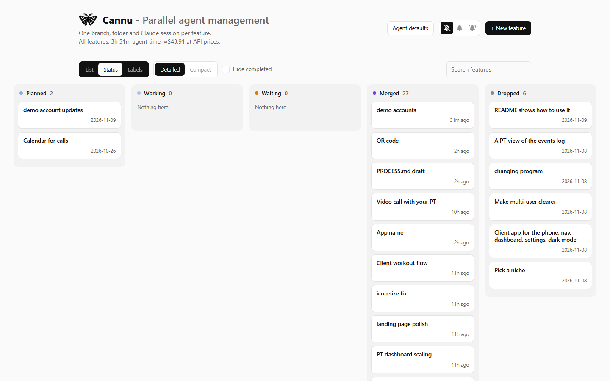
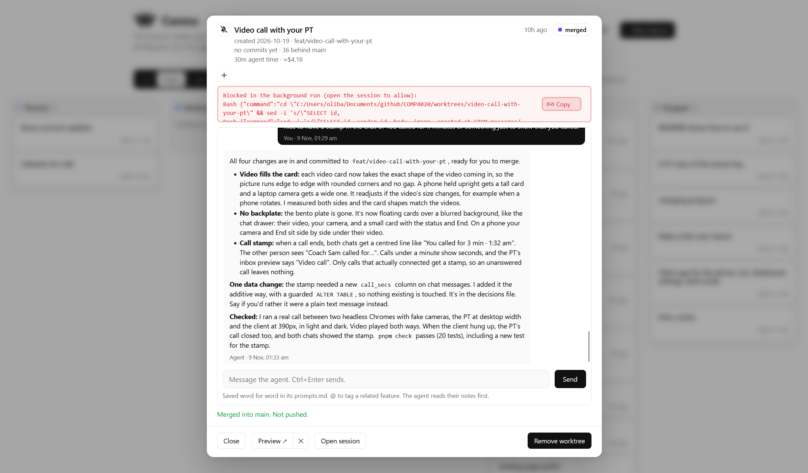
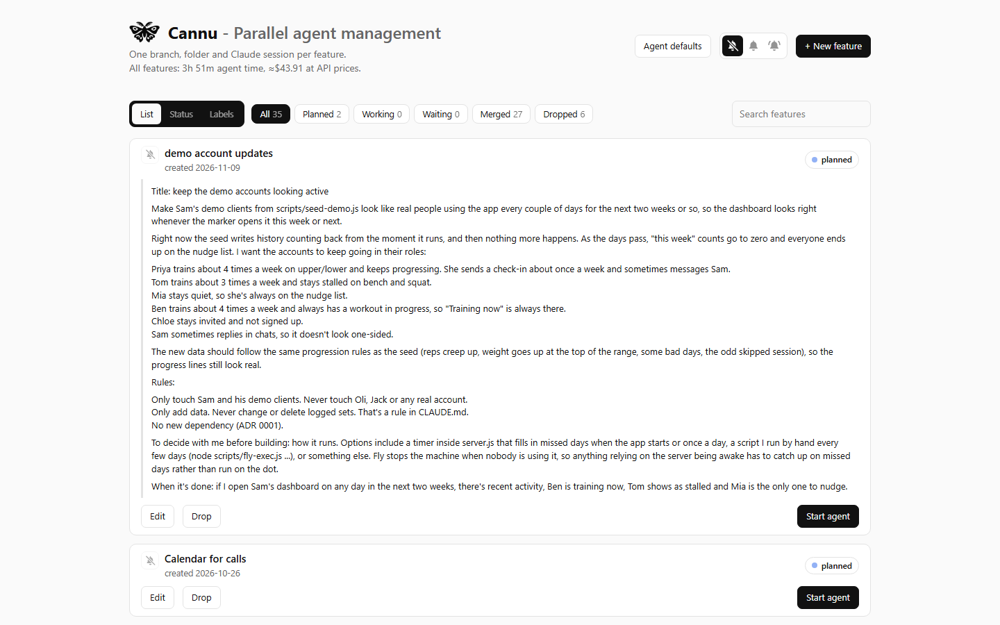
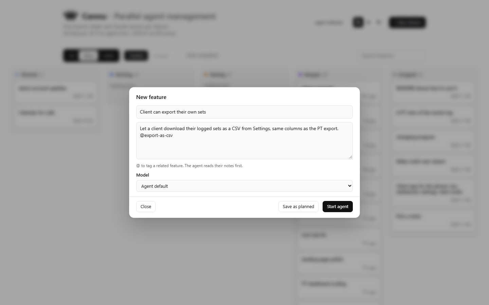

# Cannu: parallel agent management

Cannu is the dashboard I built to run Claude Code agents in parallel, one per
feature, and it's how most of Spotter got built. It isn't part of the app.
Node built-ins only, nothing to install.



**What it does**

- Each feature gets its own git branch, worktree, app port, database and
  Claude Code session, so agents never trip over each other.
- One board shows every feature by status (planned, working, waiting, merged,
  dropped), what each agent is doing, and what it's cost in time and money.
- Chat with an agent from its card and give feedback at the end of its turn,
  or open the real session in a terminal.
- Preview each feature's own copy of the app, with demo data seeded in.
- Check and merge runs `pnpm check` against the branch's own server before it
  merges into main.
- Every message I send is written word for word into the feature's
  `prompts.md` by a hook, next to the agent's `log.md` and `decisions.md`.
- Notifications when an agent needs me, finishes, fails or gets stuck.
- Agent defaults (model, system prompt, what background turns may do) are set
  in one place and committed.







**Why it's called Cannu.** It's named after Can Nü (蠶女), the silkworm girl of
Chinese myth and the goddess of silkworms and silk. Each agent is a silkworm spinning its own thread in parallel, and Cannu weaves the threads into something bigger. The logo is a
silk moth (`logo.png`).

**Where it's going.** I'm still working on it and will keep going: improving
the UX, and first making it work for other codebases, settings and
architectures, since right now it's set up for this repo on my Windows
machine. Future work happens at
[github.com/ohlai/cannu](https://github.com/ohlai/cannu).

## Running it

Trying it for the first time? Start with `../README.md`: what you need
installed, the database that isn't in the repo, and a first feature end to
end. This file is the reference for every button.

```
node server.js        # then open http://localhost:4000
```

Or double-click `start-hidden.vbs` to run it with no window (output goes to
`local/dashboard.log`). It keeps running after Claude Code closes, but not
after a restart or log out. To start it at login, put a shortcut to
`start-hidden.vbs` in `shell:startup`. Restart it after changing
`config.json`, `server.js` or `lib.js`. `index.html` is read on every load.

## Kept apart from the app

- It lives in `tools/cannu/` and nothing in the app imports it.
- The Docker image only copies `server.js`, `README.md`, the two seed scripts
  and `public/`, so it never ships.
- `pnpm check` doesn't cover it: TypeScript only checks `*.ts`, `spec/` and
  `scripts/`, and the tests only run `spec/`.
- Feature agents never edit it (`CLAUDE.md`, "Feature sessions"). It runs from
  the main folder only, even though every feature branch has a copy.
- `local/` (ports, session IDs, live state, logs) is gitignored.

## Where features are recorded

Each feature is a folder on main, `notes/features/<slug>/`:

- `feature.md`: title, status, dates and what I asked for. Only the dashboard
  writes it, and every change is a commit on main ("Start feature: X",
  "Merged: X", "Dropped: X").
- `prompts.md`: every message I sent the agent, word for word, written by a
  hook. Anything the dashboard added is after a line saying
  `[Added by the dashboard, not my words]`.
- `log.md` and `decisions.md`: what the agent did and why, and every decision.

In `feature.md` a feature is **planned** (no branch yet), **building**
(branch, folder and agent), **merged** (in main, and that's finished) or
**dropped** (kept on record, not doing it). There was a separate **done** until
2026-11-08; merged features are now done by definition. On the page, building
splits into **waiting** (its agent has stopped and it's my turn) and
**working**, so every card shows one of: waiting, working, planned, merged,
dropped. The features on the old board in `notes/features.md`
were imported on 2026-11-08, with their notes copied word for word into each
`log.md`.

## Board and list

Three views, picked with the switcher left of the search box (same sliding
style as the bells):

- **By status**: a column per status (Waiting, Working, Planned, Merged,
  Dropped). Cards move on their own as agents change.
- **By label**: a column per label, plus Unlabelled. Drag a card to another
  column to relabel it.
- **List**: the old page, cards in a list with a filter per status.

On the board, **Detailed** cards show the label (or status, by label), what a
working agent is doing and the start of a waiting agent's last reply.
**Compact** is one line per feature. **Hide completed** hides merged and
dropped. All three are remembered per browser.

Clicking a board card opens it in a popup with the cursor in the message box,
so a card moving underneath never moves what you're doing. The popup has the
card's details, its labels, the chat (tall even when it's short, and the box
grows upwards so Send stays at its bottom right) and the card's buttons.

**Labels**: one per feature, any text. Click one in the popup to set it (click
it again to clear it), or click **+**, type a new one and press Enter. Saved as
`- Label:` in `feature.md` and committed on main ("Label X: PT side"). A
label's colour comes from its name.

## What each button does

- **+ New feature** (a popup): name, what I want, and a model (the agent
  default unless I pick one, recorded in `feature.md`). What I've typed is
  kept for the browser tab if I close the popup to look at something else.
  **Start agent** commits its `feature.md` on main,
  makes `../worktrees/<slug>` on branch `feat/<slug>`, copies my local
  database into it, runs `pnpm install`, starts the feature's app, seeds Jack
  and the demo logins into it (`scripts/seed-jack.js`, which skips what's
  already there), and starts the agent on my prompt in the background. **Save as planned** only commits
  the `feature.md`.
- **Start agent / Edit / Drop** (planned features): start it as above, change
  what it says, or mark it dropped.
- **Drop** (building features): for a bad idea. Its app stops and it's
  recorded as dropped. Its folder and branch stay until **Remove worktree**,
  which commits anything uncommitted to the branch first and keeps the branch
  (it isn't merged), so the work and notes are still in git. Notes are then
  read from the branch.
- **Chat**: the conversation so far, read from Claude Code's saved transcript,
  and a box to message the agent. A message goes as a background turn
  (`claude -p --resume`). If the agent is mid-turn, it waits and goes as soon
  as the turn ends. If the session is open and idle in a terminal, sending
  closes that terminal session first, since one session can't run in two
  places. The conversation is kept, so Open session picks it back up.
  Anything a background turn wasn't allowed to do is listed in red.
- **Open session**: the same session in a Windows Terminal tab, for watching
  it live or approving something. Closing the tab ends that run of the
  session, not the session: its conversation is saved.
- **Preview ↗ | ✕**: Preview starts the feature's app if it isn't running and
  opens it. ✕ stops it. The dashboard runs each feature's
  app on its own port and data folder, so agents don't spend turns on it.
  After changing `server.js` an agent restarts it with
  `curl -s -X POST http://localhost:4000/api/features/$FEATURE_SLUG/apprestart`.
- **Check and merge**: commits the hook's `prompts.md`, refuses if the feature
  or main has uncommitted changes, starts the branch's own server on
  port + 1000, runs `pnpm check` against it, then `git merge --no-ff` into
  main. On a conflict it aborts and fills in a message asking the agent to
  merge main in. It never pushes.
- **Remove worktree**: deletes the folder and branch once merged. The feature
  stays in the list with its notes, read from main.
- **Carry on** (on an interrupted card): resumes the session with a message
  telling the agent it was cut off.
- **Retry setup**: re-runs setup. Each step skips what's already done.
  Unfinished setups also re-run when the dashboard starts.
- **Reopen** (merged or dropped features): a new feature that continues
  it. **Start agent** makes a new branch from current main and a new session
  pointed at the old notes. **Save as planned** records it as a planned
  feature instead, still pointed at the old notes, to start later from its
  card.
- **@ tagging**: typing @ in a description or a chat message lists matching
  features. Picking one writes `@slug`, which points the agent at that
  feature's notes (recorded as Related in `feature.md`).
- **Agent defaults** (a popup): everything the dashboard sends an agent. The
  default model, the system prompt, extra environment variables, the carry
  on, new session and merge conflict messages, and what background turns may
  and may never do. Saved in `agent-defaults.json` (only what differs from
  the built-in values) and committed on main. It also lists what's fixed
  because the dashboard relies on it, and what every session gets anyway
  (`CLAUDE.md` and my Claude Code plugins).
- **Ponytail**: a Claude Code plugin I have installed. It switches itself on at
  the start of every session at its own default level, which is off on my
  machine, so it was never on for agents. `agent-defaults.json` sets
  `PONYTAIL_DEFAULT_MODE=full` in the agents' environment, so every agent runs
  it at full and nothing else changes.
- **Bells**: notifications when an agent needs me, finishes, fails or is
  interrupted. Silent, only features with their bell on, or all. Every
  card has a bell before its name, struck through (no) or ringing (yes),
  never a plain bell. Muted and all set every bell and grey them out. In
  select each is off until clicked, and greyed out and unclickable while the
  feature has no agent.
  Only while the page is open.
- Filters: All, then one per status from most to least urgent (Waiting,
  Working, Planned, Merged, Dropped). All is sorted the same way, and within
  waiting, needing me comes before being cut off, then finished. Search is
  next to them. Click a card's title to fold it; its arrow turns.
- Every card ends with one row of buttons, even with its chat open: everyday
  ones on the left with Preview first, and on the right in black the one that
  moves the feature on (Start agent, Check and merge, Remove worktree). Drop,
  Check and merge and Remove worktree ask "are you sure?" in a popup first.
  There's no Notes button: the notes are in the repo.
- A card's title row (bell, arrow, title, time, status) stays put when you
  fold it; the details go underneath. The chat's message box has Send on its
  right until the text wraps, then it widens and Send slides below it.

## Waiting and working

A building feature is **working** while its agent is mid-turn or being set
up, and **waiting** otherwise. The pill adds why when it matters:

- **needs you**: it's asking for permission in its terminal.
- **terminal open**: finished its turn, and its terminal session is open.
- **interrupted**: it was mid-turn when its process died. Use Carry on.
- **error**: the last background run failed. Its output is on the card.
- **never started**: the agent never got going.
- **stuck**: it's mid-turn, but nothing has happened for 3 minutes: no hook
  report and nothing written to its transcript. The card says what's still
  running under the agent (usually a hook or a command that has hung), with
  **End that step** to kill just that, so the agent carries on. For a
  background turn there's also **Stop the turn**, after which Carry on picks it
  back up. Stuck cards sort to the top with needs you, and ring the bell.
- No detail: finished its turn, no session running. Messages go straight to it.

Liveness comes from the claude process IDs that `launch.js` and background
runs record, checked against `tasklist`.

## How it knows what agents are doing

Each worktree gets a gitignored `.claude/settings.local.json` with its `PORT`,
`DATA_DIR`, `APP_URL`, git identity, and hooks that run this folder's
`hook.js`. It's rewritten whenever the dashboard starts. It also turns off
the GitKraken hooks plugin for agents (it held a permission request open for
20 minutes waiting for an answer in GitKraken) and turns off the Claude
co-author line on their commits. The hook writes
`local/state/<slug>.json` and appends every message to the feature's
`prompts.md`. Time and cost per feature come from the transcripts Claude Code
saves under `~/.claude/projects/`, priced at API rates.

## Config

`config.json`. `claudeSettings` is the path to a settings file with the
course API key, passed to Claude with `--settings` so this dashboard never
reads the key. On a subscription, set it to `""`. `headlessAllowedTools` and
`headlessDisallowedTools` are the built-in permissions for background turns,
which Agent defaults can override. `defaultsFile` moves `agent-defaults.json`
(used to test on a throwaway clone).
